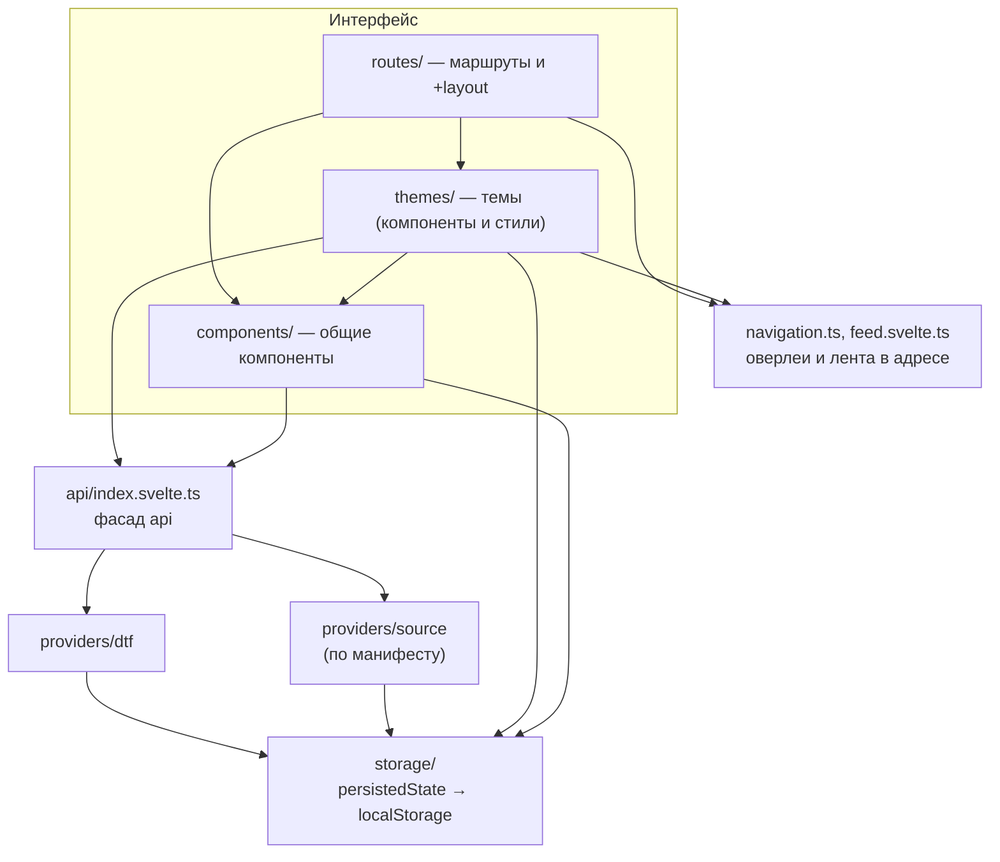

# Архитектура reDTF

Обзор приложения. Детали по каждой части — в соседних документах.

## Принципы

1. **Статичное SPA.** Нет сервера и SSR (`ssr = false`, `adapter-static`). Все запросы делает браузер пользователя, это можно проверить в DevTools. Подробности: [ADR 0001](../../decisions/0001-static-spa-without-ssr.md).
2. **Одна точка входа для данных.** UI знает только фасад `api`. Откуда данные (DTF, подключённый источник) и как они слиты, решает фасад.
3. **Тема — это набор компонентов.** Логика, данные и навигация общие, а разметка и оформление принадлежат теме. Темы можно наследовать.
4. **Всё, что запоминается, — в одном слое хранилища** с понятными ключами и ясным различием между настройками, секретами и кэшем.
5. **Прозрачность и минимум зависимостей.** Размер бандла важен, тяжёлое грузится лениво.

## Слои



Правила зависимостей: UI не импортирует провайдеры; провайдеры не знают про UI; `storage` ни от чего не зависит (кроме типов); тема не импортирует другую тему, кроме своей основы (`extends`).

## Структура каталогов

```
src/
  app.html, app.css, app.d.ts   оболочка, сброс стилей, типы PageState (оверлеи)
  routes/
    +layout.svelte              тема, стили темы, стек оверлеев, восстановление прокрутки
    +page.svelte                лента (/ и /?feed=new)
    post/[id], u/[id]           страницы поста и профиля по прямой ссылке
    notifications, search, tag  уведомления, поиск, теги
    drafts, settings, write, …  черновики, настройки, редактор, вход
    api/version.json            статический эндпоинт текущей версии
  lib/
    navigation.ts               openOverlay, closeOverlay, openPost, openProfile, openFeed
    feed.svelte.ts              ленты, текущая лента, обновление
    motion.ts                   анимации темы (ThemeMotion), кривые, play
    ready.ts                    ожидание картинок окна и отрисовки кадра
    capacitor/                  нативный слой Android и OTA-обновления (Capgo)
    icons/                      иконки приложения и SVG-спрайты
    api/
      index.svelte.ts           фасад
      types.ts                  модель данных и интерфейс ApiProvider
      currentUser.svelte.ts     вошедший пользователь и его кэш
      providers/dtf/            провайдер DTF: client, auth, mappers, методы
      providers/source.ts       провайдер подключаемого источника
      sources/                  манифесты, разрешения, реестр, слияние, авторизация источников
    themes/
      registry.ts, types.ts     реестр, манифест, схема настроек
      contract.ts               какие компоненты и с какими пропсами есть у темы
      ThemeLoader.svelte        рисует компонент активной темы
      settings.svelte.ts        настройки темы
      <id>/                     тема: theme.ts, theme.css, компоненты
    storage/                    persistedState и хранилища: настройки, сессия, источники
    components/                 BlockRenderer, Comments, editor, settings, sources, overlays
docs/                           документация
```

## Жизненный цикл запуска

1. `app.html` сразу показывает заставку, SvelteKit загружает корневой layout. Он убирает заставку или, при первом запуске, превращает её в приветствие ([splash.md](splash.md)).
2. `+layout.svelte` берёт активную тему из настроек, лениво подключает её стили и после загрузки ставит `data-theme` на `<html>`.
3. `ThemeLoader` рисует `Header`, `MainLayout` и содержимое страницы: каждый компонент берётся у активной темы (или её основы).
4. Страница ленты читает `?feed=` из адреса и просит у фасада посты. Фасад опрашивает DTF и подключённые источники, сливает ответы.
5. Клик по посту или профилю открывает оверлей: адрес меняется, лента остаётся под ним, прокрутка сохраняется.

## Документы

- [storage.md](storage.md) — слои localStorage, ключи, формат
- [themes.md](themes.md) — реестр, контракт, стили, форки
- [settings.md](settings.md) — общие настройки и настройки темы
- [navigation.md](navigation.md) — оверлеи, лента в адресе, прямые ссылки
- [motion.md](motion.md) — отклик на нажатия, подложка и спиннер окон, анимации темы
- [splash.md](splash.md) — заставка при запуске и приветствие первого входа
- [api.md](api.md) — фасад, провайдеры, ошибки, текущий пользователь
- [mobile.md](mobile.md) — мобильное приложение (Capacitor 8, Android, OTA-обновления)
- [data-sources/](data-sources/README.md) — подключаемые источники
- [../../decisions/](../../decisions/README.md) — почему так сделано
